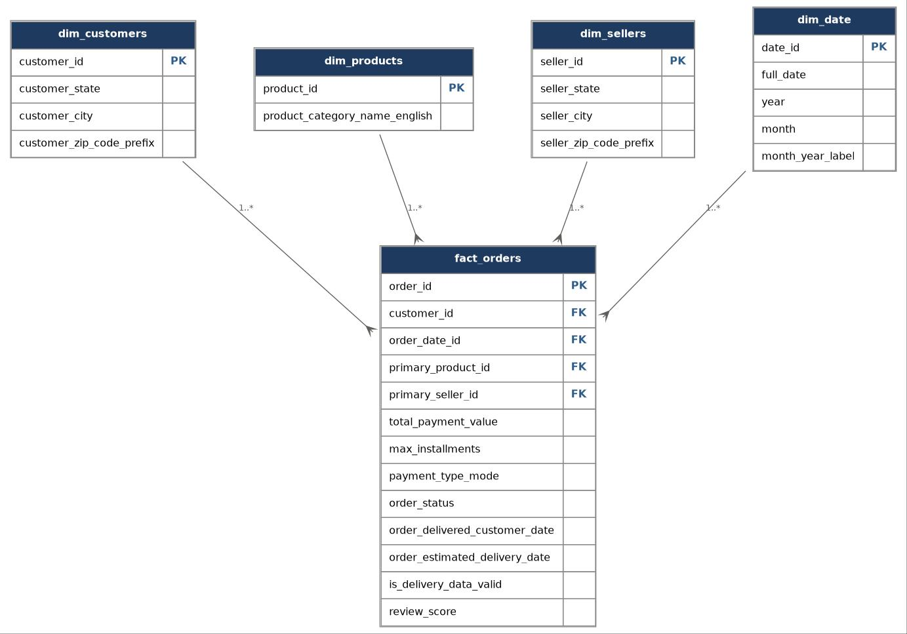
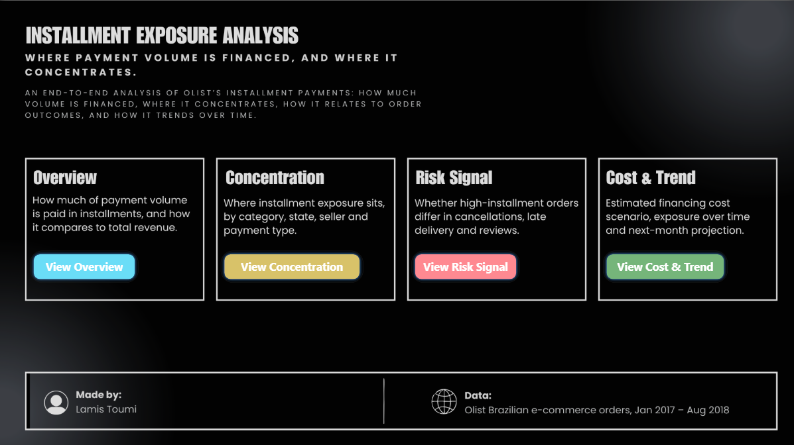
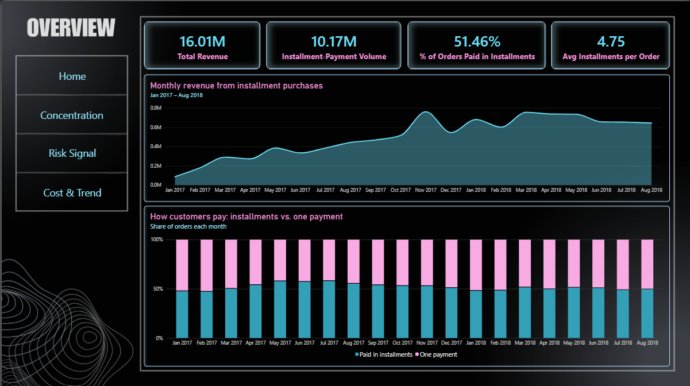
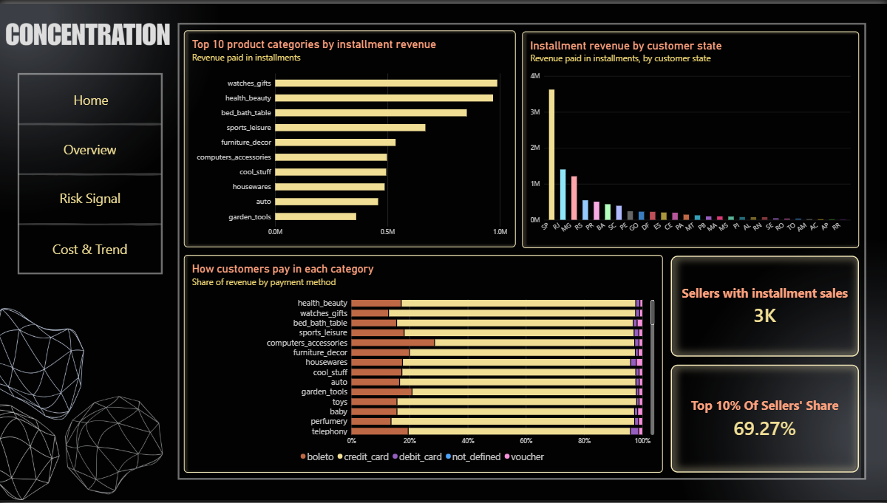
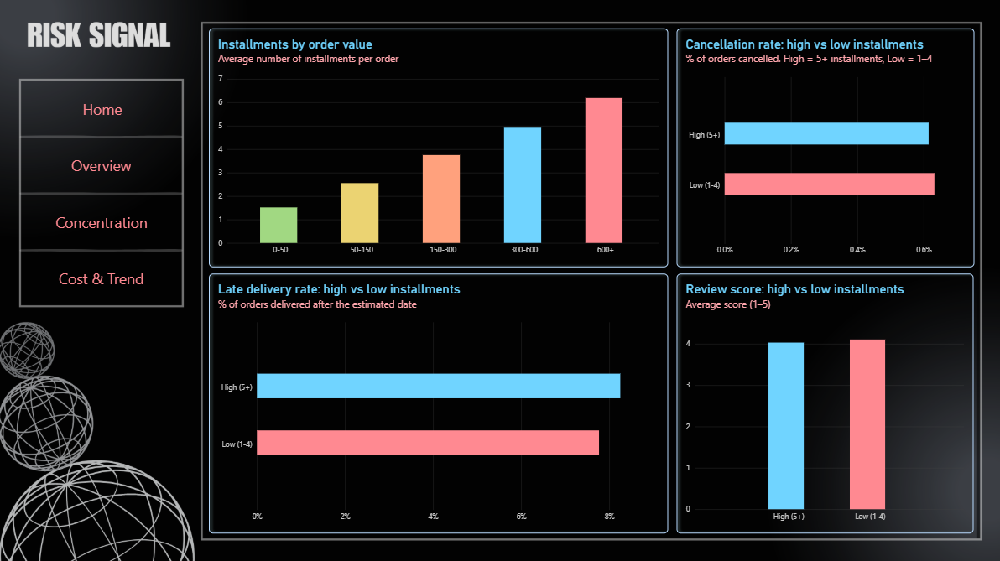
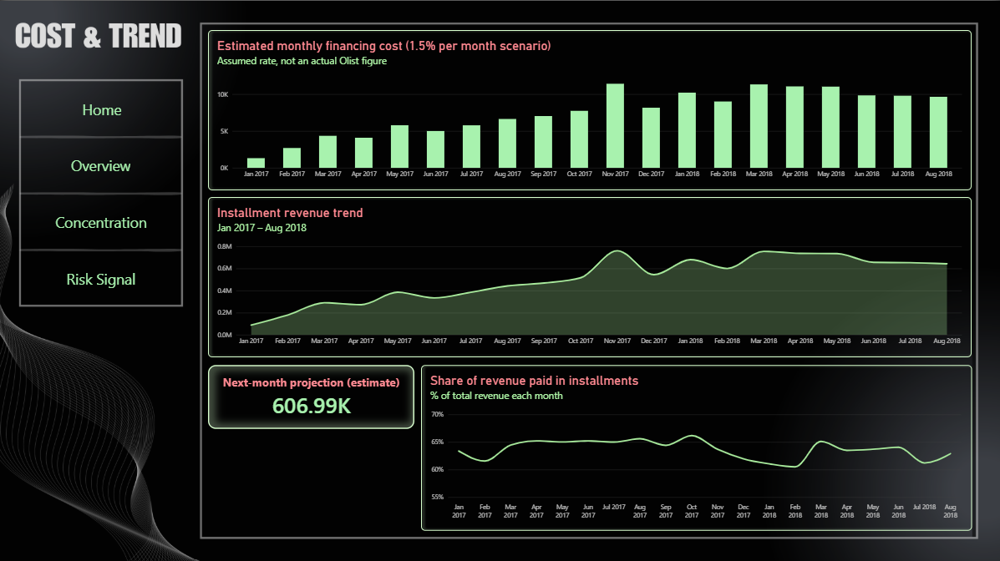

<div align="center">

# 💳 Installment Exposure Analysis

### An End-to-End BI Data Warehouse on Brazilian E-Commerce Data

<p>
  
  
  
  
</p>

**How much of Olist's payment volume is paid in installments, and where is that installment-payment exposure concentrated?**

A portfolio project covering the full BI chain: raw CSVs → Python ETL → PostgreSQL star schema → 4-page Power BI dashboard.

</div>

---

## 📑 Table of Contents

- [1. Project Overview](#-1-project-overview)
- [2. Dataset](#-2-dataset)
- [3. Business Questions and KPIs](#-3-business-questions-and-kpis)
- [4. Architecture and Data Model](#-4-architecture-and-data-model)
- [5. Data Preparation and Quality](#-5-data-preparation-and-quality)
- [6. Dashboard](#-6-dashboard)
- [7. Key Findings](#-7-key-findings)
- [8. Assumptions and Limitations](#-8-assumptions-and-limitations)
- [9. How to Run](#-9-how-to-run)
- [10. Project Structure](#-10-project-structure)
- [11. Technologies Used](#-11-technologies-used)

---

## 🎯 1. Project Overview

Olist is a Brazilian online marketplace. Customers can pay for an order in one payment or split it into installments, typically on a credit card. This project measures how much of the business is paid this way, where that volume is concentrated, whether installment orders behave differently from other orders, and how the volume changes over time.

### Why installments?

Paying in installments is a common way to buy in Brazil, and it matters to a marketplace for three reasons:

- **It supports sales.** Splitting a payment makes larger purchases affordable, so installments can raise order values and conversion. The data shows this directly: the number of installments rises with order value.
- **It affects cash flow.** When a customer pays over several months, the money for that order does not arrive in one piece. Someone has to carry that gap, whether the marketplace, the seller or the card issuer, and carrying it has a cost.
- **It creates concentration and risk.** If a large share of revenue depends on installments, and that volume sits in a few regions or sellers, a problem in one of them can affect a large part of the business.

### What would be a troubling finding?

The dashboard is designed to show warning signs. These are the findings that would call for attention:

| If we found... | Why it would matter |
|---|---|
| A rising share of revenue paid in installments | Growing dependence on financing, and more cash tied up over time |
| Volume concentrated in a few sellers, states or categories | One failing seller, a regional downturn or a category slump would hit a large share of the business |
| Higher cancellations, late deliveries or lower reviews on high-installment orders | Customers who are still paying for an order they are unhappy with or never received, which raises the risk of disputes, refunds and unpaid balances |
| Financing costs growing faster than revenue | Margins shrink, because the cost of carrying installments rises faster than sales |

### What the analysis found

The share paid in installments is large but stable, the volume is concentrated, and high-installment orders show no substantial difference in cancellations, late delivery or reviews (see [Key Findings](#-7-key-findings)). The data has limits: it cannot show who finances the installments or what is still unpaid (see [Assumptions and Limitations](#-8-assumptions-and-limitations)).

The project was built to practice the full BI workflow and to document every decision on the way, from data understanding to the final dashboard. The work followed the CRISP-DM phases, and every cleaning decision is recorded in [`data_quality_log.md`](data_quality_log.md).

### Objectives

- Quantify how much payment volume is paid in installments.
- Show where that volume is concentrated: category, state, seller and payment type.
- Check whether high-installment orders differ in cancellations, late delivery and review scores.
- Show the trend over time, a next-month projection and an estimated financing-cost scenario.

---

## 📊 2. Dataset

The project uses the **Olist Brazilian E-Commerce Public Dataset** (Kaggle), which contains about 100,000 orders placed between 2016 and 2018.

**Source:** [Kaggle: Brazilian E-Commerce Public Dataset by Olist](https://www.kaggle.com/datasets/olistbr/brazilian-ecommerce)

| Attribute | Value |
|---|---|
| Source CSV files | 9 (8 used; the geolocation table was not needed for any KPI) |
| Orders in the warehouse | 99,441 |
| Analysis window | Jan 2017 – Aug 2018 (edge months have too few orders to be meaningful) |
| Grain of the fact table | One row per order |

> The CSV files are not included in this repository. Download them from Kaggle and place them in a `data/` folder (see [How to Run](#-9-how-to-run)).

---

## ❓ 3. Business Questions and KPIs

**Main question:** How much of Olist's payment volume is paid in installments, and where is that installment-payment exposure concentrated?

| Page | Sub-question | KPIs |
|---|---|---|
| **1. Overview** | How big is the installment volume? | Total revenue, installment-payment volume, % of orders paid in installments, average installments per order |
| **2. Concentration** | Where is it concentrated? | Revenue by category, by customer state, top 10% of sellers' share, payment-type mix per category |
| **3. Risk Signal** | Do high-installment orders differ in outcomes? | Installments by order value, cancellation rate, late-delivery rate, review score (high vs low installments) |
| **4. Cost & Trend** | What does it cost and how does it change? | Estimated financing-cost scenario, installment revenue trend, next-month projection, installment share of revenue over time |

**Definitions used throughout:**
- **Installment order:** an order whose payments total more than one installment (`max_installments > 1`).
- **High vs low installments:** split at the median installment count of installment orders (4). High = 5 or more, Low = 1 to 4.

---

## 🏗️ 4. Architecture and Data Model

This is an **ETL** design: Python transforms the data *before* it is loaded, PostgreSQL is the warehouse, and Power BI is the consumer.

```
Raw CSVs  →  Python (pandas) ETL  →  PostgreSQL star schema  →  Power BI dashboard
```

### Star schema

One fact table (one row per order) surrounded by four dimensions.

<p align="center">
  
</p>

| Table | Role | Key columns |
|---|---|---|
| `fact_orders` | Fact (one row per order) | `order_id`, `customer_id`, `order_date_id`, `primary_product_id`, `primary_seller_id`, `total_payment_value`, `max_installments`, `payment_type_mode`, `order_status`, delivery dates, `review_score` |
| `dim_customers` | Dimension | `customer_id`, state, city, zip prefix |
| `dim_products` | Dimension | `product_id`, English category name |
| `dim_sellers` | Dimension | `seller_id`, state, city, zip prefix |
| `dim_date` | Dimension (generated calendar) | `date_id`, full date, year, month, month label, month sort key |

**Modeling decisions**
- **Star schema, not snowflake.** Simpler for BI tools and faster to query for this size of data.
- **Grain = one order.** Orders with several items use the highest-priced item as the "primary" product and seller. Other items are not represented in the fact table, which is a documented trade-off.
- **Payments aggregated per order.** About 3% of orders have more than one payment row, so payment value is summed and installments take the maximum, to avoid double counting.
- **`customer_state` for regional exposure.** Exposure follows where the paying customer is, not where the seller operates.

---

## 🧹 5. Data Preparation and Quality

Each of the tables was profiled before any cleaning (nulls, duplicates, ranges, consistency between columns). The full reasoning is in [`data_quality_log.md`](data_quality_log.md). The main fixes applied in `data_preparation.py`:

| Issue found | Decision |
|---|---|
| 8 orders marked "delivered" with no delivery date | Kept, but flagged with `is_delivery_data_valid` and excluded from delivery metrics |
| 2 payments with 0 installments | Corrected to 1 installment |
| Some orders have several payment rows | Aggregated to one row per order (sum of value, max installments) |
| Same review linked to several orders, and 243 orders with two different reviews | De-duplicated twice (by `review_id`, then by `order_id`) so the fact table keeps one row per order |
| Product categories missing or untranslated | Two categories mapped manually; the rest labeled "Unknown/Uncategorized" |
| Near-empty months at the edges of the data | Trend charts limited to Jan 2017 – Aug 2018 |

The database password is stored in a `.env` file (excluded from Git by `.gitignore`), not in the code.

---

## 🖥️ 6. Dashboard

A four-page Power BI dashboard with a home page and consistent navigation. A [PDF copy](images/Olist_Installment_Dashboard.pdf) of all pages is included.

**Home**

<p align="center">
  
</p>

**1. Overview:** how much volume is paid in installments

<p align="center">
  
</p>

**2. Concentration:** where the volume sits

<p align="center">
  
</p>

**3. Risk Signal:** do high-installment orders differ in outcomes?

<p align="center">
  
</p>

**4. Cost & Trend:** cost scenario, trend and projection

<p align="center">
  
</p>

---

## 💡 7. Key Findings

**1. Installments are a large part of the business.**
About 51% of orders and about 63% of payment volume (10.17M of 16.01M) are paid in installments. An installment order averages 4.75 installments. Installment orders are larger on average, which is why they hold a bigger share of volume than of orders.

**2. The share is stable over time.**
Installment revenue grew from about 0.1M a month (Jan 2017) to about 0.65M (Aug 2018) and levelled off in 2018. Its share of total revenue stayed within roughly 60–66% throughout, so installment volume grew in step with sales and not faster.

**3. The volume is concentrated.**
São Paulo leads by customer state by a wide margin. The top 10% of sellers account for about 69% of installment volume. A small number of categories (such as watches/gifts, health/beauty and bed/bath/table) lead the category ranking.

**4. Installment count follows order value.**
The average number of installments rises steadily with order value, from about 1.5 for the smallest orders to about 6 for orders above 600.

**5. No substantial differences in the measured outcomes.**
Comparing high (5+) and low (1–4) installment orders: cancellation rates are both about 0.6%, late delivery is 8.25% vs 7.87%, and average review scores are about 4.0 vs 4.1. These differences are small. They were not tested for statistical significance, so the finding is that no substantial difference appears in these three measures, not that financing has no effect on risk.

**6. The estimated cost is modest under the scenario assumed.**
At an assumed 1.5% a month on installment volume, the estimated monthly financing cost peaks at about 10K. This is a scenario, not an Olist figure (see below).

---

## ⚠️ 8. Assumptions and Limitations

- **"Exposure" means installment-payment volume, not cash advanced.** The dataset does not show who finances the installments (Olist, the card issuer or the seller) or when Olist receives the money. It also has no repayment schedule, so remaining unpaid balances cannot be measured.
- **The financing cost is a scenario.** The 1.5% monthly rate (roughly 18% annualized) is an illustrative assumption. The dataset contains no real financing cost.
- **Next-month projection is a rough estimate.** It is a simple linear trend over the last 6 months (Mar–Aug 2018), chosen because growth levelled off in 2018. It is not a forecasting model and ignores seasonality.
- **Cancellation is a risk proxy**, not a confirmed financial loss. There is no refund data.
- **The high/low installment split** (at 4) is based on the median of installment orders. Different thresholds could give different comparisons.
- **Single dataset, 2016–2018.** The findings describe this period and may not hold today.
- **Power BI refresh.** The `.pbix` file imports data from a local PostgreSQL database. The report opens and works for anyone, but "Refresh" only works with the same local database.

---

## 🚀 9. How to Run

**Requirements:** Python 3.10+, PostgreSQL, Power BI Desktop (to open the `.pbix`).

```bash
pip install pandas sqlalchemy psycopg2-binary python-dotenv
```

1. **Download the data** from [Kaggle](https://www.kaggle.com/datasets/olistbr/brazilian-ecommerce) and put the CSV files in a `data/` folder in the project root.
2. **Create the database** in PostgreSQL:
   ```sql
   CREATE DATABASE olist_dwh;
   ```
3. **Add your password** in a `.env` file in the project root:
   ```
   OLIST_DB_PASSWORD=your_password_here
   ```
4. **Build and load the warehouse** (this runs the whole ETL and creates the five tables):
   ```bash
   python 03_load_to_postgres.py
   ```
   Close Power BI first if it is open on the same database, because an open connection can lock the tables.
5. **Open the dashboard:** open `olist_dashboard.pbix` in Power BI Desktop. To refresh it against your own database, update the PostgreSQL connection in Transform data → Data source settings.

`data_preparation.py` can also be run on its own to print row counts and check that every order matches a date in the date dimension.

---

## 📁 10. Project Structure

```
olist-dwh-project/
├── data/                              # raw CSVs (not committed)
├── images/                            # dashboard screenshots and PDF
├── 01_data_understanding.py           # profiling of the raw tables
├── 02_data_preparation_exploratory.py # investigation script (kept as a record)
├── data_preparation.py                # ETL: builds the star schema
├── 03_load_to_postgres.py             # loads the tables into PostgreSQL
├── data_quality_log.md                # every finding and decision
├── olist_star_schema.jpg              # star schema diagram
├── olist_dashboard.pbix               # Power BI report
├── .env                               # database password (not committed)
└── .gitignore
```

---

## 🧰 11. Technologies Used

| Technology | Purpose |
|---|---|
| Python (pandas) | Data profiling, cleaning and star-schema construction |
| SQLAlchemy, psycopg2 | Loading the tables into PostgreSQL |
| python-dotenv | Keeping credentials out of the code |
| PostgreSQL / pgAdmin | Data warehouse and verification queries |
| Power BI (DAX) | Data model, measures and the four-page dashboard |
| draw.io | Star schema diagram |

---

## 🌷 Conclusion

Around 63% of Olist's payment volume is paid in installments, and that share stays steady across the period. The exposure is concentrated in São Paulo and in a small group of sellers, and orders with many installments show no substantial difference in cancellations, late delivery or reviews. The limits of the data matter as much as the findings: it cannot show who finances the installments, and the cost shown is a scenario.

---

<div align="center">

**Built by Lamis Toumi** · Business Intelligence · Python · PostgreSQL · Power BI

</div>